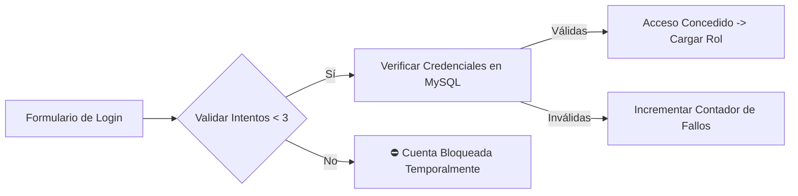
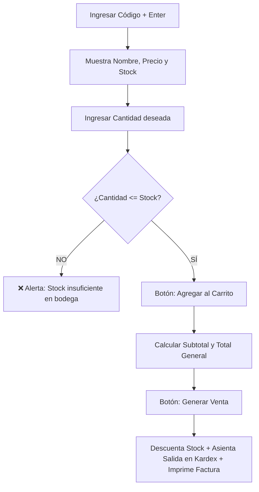
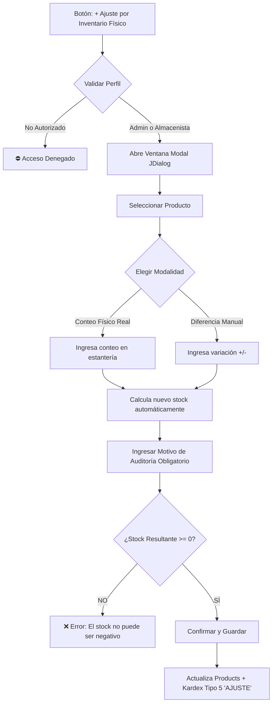

# 📘 Manual de Usuario — Tienda Gamer

<div align="center">


### **Sistema de Información para la Gestión de Inventarios, Ventas y Abastecimiento**
**Asignaturas**: Base de Datos & Programación I  
**Institución**: Ingeniería de Sistemas / Tecnología en Sistemas de Información  
**Versión del Software**: 2.0.0 (Edición Cloud & Local)

---
</div>

## 📑 Tabla de Contenido
1. [Introducción y Objetivos](#1-introducción-y-objetivos)
2. [Requisitos del Sistema e Inicio de la Aplicación](#2-requisitos-del-sistema-e-inicio-de-la-aplicación)
3. [Control de Acceso y Seguridad (Login & Perfil)](#3-control-de-acceso-y-seguridad-login--perfil)
4. [Matriz de Roles y Navegación (RBAC)](#4-matriz-de-roles-y-navegación-rbac)
5. [Módulo de Punto de Venta y Facturación](#5-módulo-de-punto-de-venta-y-facturación)
6. [Módulo de Compras y Abastecimiento](#6-módulo-de-compras-y-abastecimiento)
7. [Módulo de Kardex y Auditoría de Inventario](#7-módulo-de-kardex-y-auditoría-de-inventario)
8. [Módulo de Ajustes por Inventario Físico (Bodega)](#8-módulo-de-ajustes-por-inventario-físico-bodega)
9. [Catálogo de Productos y Categorías](#9-catálogo-de-productos-y-categorías)
10. [Administración de Clientes y Proveedores](#10-administración-de-clientes-y-proveedores)
11. [Gestión de Empleados, Nómina y Sueldos](#11-gestión-de-empleados-nómina-y-sueldos)
12. [Personalización: Tema Claro y Oscuro](#12-personalización-tema-claro-y-oscuro)
13. [Preguntas Frecuentes y Solución de Problemas](#13-preguntas-frecuentes-y-solución-de-problemas)
14. [Glosario de Términos](#14-glosario-de-términos)

---

## 1. Introducción y Objetivos

El **Sistema de Gestión Tienda Gamer** es una solución de escritorio desarrollada en **Java Swing** con arquitectura **Modelo-Vista-Controlador (MVC)** y persistencia relacional en **MySQL**.

### Objetivos Clave:
* **Control Integral de Mercancía**: Registro atómico de movimientos de entrada, salida y ajustes mediante un sistema de **Kardex** en tiempo real.
* **Seguridad Basada en Roles (RBAC)**: Segregación estricta de funciones entre gerencia, compras, almacén y ventas.
* **Trazabilidad y Auditoría**: Registro de accesos y cierres automáticos por inactividad para garantizar la integridad operativa.
* **Flexibilidad de Despliegue**: Capacidad de operar tanto de manera local (XAMPP/localhost) como en la nube global (Aiven Cloud con cifrado SSL).

---

## 2. Requisitos del Sistema e Inicio de la Aplicación

### Requisitos Mínimos:
* **Sistema Operativo**: Windows 10/11, macOS o Linux.
* **Java Runtime**: JRE o JDK 17 o superior (verificado con JDK 25 Adoptium).
* **Resolución de Pantalla**: Mínimo 1280 × 720 píxeles.
* **Conexión a Red**: Requerida si se utiliza la base de datos en la nube (Aiven); opcional si se opera localmente con XAMPP.

### Cómo Iniciar el Sistema:
1. Desde **Apache NetBeans**: Abrir el proyecto y presionar **F6** o hacer clic en **Run Project**.
2. Desde archivo ejecutable: Hacer doble clic sobre `dist/TIENDA_GAMER.jar` o mediante consola:
   ```bash
   java -jar dist/TIENDA_GAMER.jar
   ```

---

## 3. Control de Acceso y Seguridad (Login & Perfil)

El acceso al sistema está restringido mediante credenciales individuales cifradas con hash **MD5**.



### 3.1 Procedimiento de Inicio de Sesión:
1. En la pantalla inicial (`LoginView`), ingrese su **Usuario** y **Contraseña**.
2. Presione la tecla **Enter** o haga clic en el botón **Ingresar**.
3. El sistema verificará su identidad y abrirá automáticamente la ventana principal (`SystemView`), situándolo en la pestaña operativa que le corresponde a su perfil.

> [!WARNING]
> **Política de Bloqueo por Fuerza Bruta**: Si ingresa la contraseña incorrecta **3 veces consecutivas**, el sistema bloqueará temporalmente el botón de ingreso para salvaguardar la seguridad de la información.

### 3.2 Temporizador de Inactividad (15 Minutos):
Por protocolo de seguridad corporativa, si el usuario no realiza ninguna acción (movimiento de mouse o pulsación de teclas) durante **15 minutos consecutivos**, el sistema:
1. Guardará el evento de suspensión en la tabla `activity_log`.
2. Cerrará la sesión actual automáticamente.
3. Regresará a la pantalla de Login solicitando nuevamente las credenciales.

### 3.3 Gestión de Perfil y Cambio de Contraseña:
1. Haga clic en la opción **Perfil** en la barra lateral.
2. Podrá visualizar su ID de colaborador, nombre completo y rol asignado.
3. Ingrese su nueva contraseña en el campo correspondiente y presione **Modificar**. La nueva clave se encriptará de inmediato.

---

## 4. Matriz de Roles y Navegación (RBAC)

El sistema implementa una matriz estricta de **Control de Acceso Basado en Roles (RBAC)** que restringe la visibilidad de pestañas y botones según el cargo del colaborador:

| Módulo / Función | Administrador General | Jefe de Compras | Almacenista / Bodega | Vendedor / Cajero |
| :--- | :---: | :---: | :---: | :---: |
| **Pestaña Inicial por Defecto** | Productos | Compras | Kardex | Ventas |
| **Punto de Venta (Ventas)** | ✅ Total | ❌ Bloqueado | ❌ Bloqueado | ✅ Operativo |
| **Compras y Proveedores** | ✅ Total | ✅ Operativo | ❌ Bloqueado | ❌ Bloqueado |
| **Kardex (Historial)** | ✅ Total | ❌ Bloqueado | ✅ Operativo | ❌ Bloqueado |
| **Ajuste de Inventario Físico** | ✅ Total | ❌ Bloqueado | ✅ Operativo | ❌ Bloqueado |
| **Catálogo de Productos** | ✅ Edición Total | 👁️ Solo Lectura | 👁️ Solo Lectura | 👁️ Solo Lectura |
| **Gestión de Clientes** | ✅ Total | ❌ Bloqueado | ❌ Bloqueado | ✅ Operativo |
| **Empleados y Asignación de Roles**| ✅ Total | ❌ Bloqueado | ❌ Bloqueado | ❌ Bloqueado |
| **Edición de Salarios / Nómina** | ✅ Exclusivo | ❌ Bloqueado | ❌ Bloqueado | ❌ Bloqueado |
| **Reportes y Gráficos** | ✅ Total | ❌ Bloqueado | ❌ Bloqueado | ❌ Bloqueado |

> [!NOTE]
> Los usuarios con roles no autorizados verán los módulos restringidos completamente deshabilitados o con alertas disuasivas: *"Acceso Denegado: Su rol no cuenta con privilegios para esta operación"*.

---

## 5. Módulo de Punto de Venta y Facturación

Destinado a la atención directa al cliente, agilizando el despacho de productos gamer y garantizando que **nunca se venda mercancía sin existencias en bodega**.



### 5.1 Paso a Paso para Registrar una Venta:
1. Diríjase a la pestaña **Ventas** desde el menú lateral.
2. Ingrese el código del producto en el campo **Código** y presione **Enter** (o escanee con lector de código de barras).
3. El sistema autocompletará la descripción, el precio unitario y mostrará el **Stock disponible en tiempo real**.
4. Ingrese la **Cantidad** que el cliente desea adquirir.
5. Haga clic en el botón **Agregar**.
   * *Validación de Seguridad*: Si la cantidad supera las existencias reales, el sistema impedirá el ingreso y emitirá una alerta.
6. Repita los pasos anteriores para agregar más artículos al carrito de compra.
7. Seleccione el cliente registrado en el combo box o ingrese uno nuevo.
8. Haga clic en el botón **Generar Venta**:
   * Se creará la factura en la base de datos.
   * Se descontarán automáticamente las unidades vendidas en la tabla `products`.
   * Se registrará una transacción de **SALIDA** en el **Kardex** bajo el tipo `VENTA`.
   * Se abrirá la vista previa del comprobante listo para imprimir.

### 5.2 Anulación y Devolución de Ventas:
* En caso de devolución del producto por garantía o cambio, el Administrador puede anular la factura.
* El sistema **reintegrará de inmediato el stock al almacén** y asentará un movimiento de **ENTRADA** por `DEVOLUCION CLIENTE` en el Kardex.

---

## 6. Módulo de Compras y Abastecimiento

Permite gestionar la adquisición de mercancía con proveedores autorizados para reabastecer el inventario.

### Procedimiento de Compra:
1. Seleccione la pestaña **Compras**.
2. Elija el **Proveedor** en la lista desplegable.
3. Ingrese el código o seleccione el producto a reabastecer.
4. Especifique la **Cantidad** adquirida y el **Precio de Compra** unitario pactado.
5. Haga clic en **Agregar** para incluir el producto en el lote de compra.
6. Al finalizar el lote, presione el botón **Comprar**:
   * Se registrará el documento de ingreso en `purchases`.
   * Se incrementará el stock del producto en bodega.
   * Se generará un registro de **ENTRADA** en el **Kardex** bajo el tipo `COMPRA`.

---

## 7. Módulo de Kardex y Auditoría de Inventario

El Kardex es el cerebro contable del inventario. Registra de forma inmutable cada unidad que entra o sale de la tienda.

### 7.1 Componentes de la Pantalla de Kardex:
* **Tarjetas KPI Superiores**:
  * 📦 **Total Movimientos**: Volumen histórico acumulado de operaciones.
  * 🟢 **Entradas**: Unidades ingresadas por compras o devoluciones.
  * 🔴 **Salidas**: Unidades despachadas por ventas o devoluciones a proveedores.
  * 🟣 **Ajustes de Bodega**: Modificaciones manuales por auditoría física.
* **Buscador Dinámico**: Permite filtrar instantáneamente por código o nombre de producto.
* **Filtro por Tipo de Movimiento**: Selector para auditar transacciones específicas (`VENTA`, `COMPRA`, `DEVOLUCION CLIENTE`, `DEVOLUCION PROVEEDOR`, `AJUSTE INVENTARIO`).
* **Semáforo Visual en Tabla**:
  * **Verde (#2ecc71)**: Movimientos con efecto positivo (`ENTRADA`).
  * **Rojo (#e74c3c)**: Movimientos con efecto negativo (`SALIDA`).
  * **Índigo (#6366f1)**: Movimientos de regularización (`AJUSTE`).

---

## 8. Módulo de Ajustes por Inventario Físico (Bodega)

Permite conciliar discrepancias entre las existencias registradas en el sistema y el conteo físico verificado en los estantes de bodega (mermas, averías, garantías o sobrantes).



### 8.1 Paso a Paso para Realizar un Ajuste:
1. En la pestaña **Kardex**, haga clic en el botón superior:  
   👉 **`+ Ajuste por Inventario Físico`**.
2. En la ventana modal emergente:
   * **Producto**: Seleccione el artículo a auditar. El sistema mostrará su stock teórico actual.
   * **Modalidad**:
     * **Modo Conteo Físico**: Ingrese el número total de unidades contadas en la estantería. El sistema calculará la diferencia (+ o -) de forma automática.
     * **Modo Diferencia**: Ingrese directamente la cantidad a sumar o restar (por ejemplo `-2` por rotura de empaque o `+1` por mercancía recuperada).
   * **Motivo / Observación**: Ingrese una justificación clara y detallada (ej. *\"Auditoría mensual de bodega - 1 unidad averiada en transporte\"*). **Campo obligatorio**.
3. Haga clic en **Guardar Ajuste**:
   * El sistema validará que el stock final no resulte negativo.
   * Se actualizará la existencia en la tabla `products`.
   * Se asentará el registro en `kardex` bajo el tipo `5` (`AJUSTE INVENTARIO`).
   * Las tablas y tarjetas de Kardex se refrescarán en vivo.

---

## 9. Catálogo de Productos y Categorías

### 9.1 Registro y Modificación de Productos:
* **Código**: Identificador numérico único o código de barras.
* **Nombre y Descripción**: Especificaciones del componente o accesorio gamer (ej. *Mouse Óptico RGB 16000 DPI*).
* **Precio Unitario**: Precio de venta al público en moneda local.
* **Categoría**: Clasificación relacional (`Consolas`, `Periféricos`, `Sillas Gamer`, `Componentes PC`).

> [!TIP]
> **Borrado Lógico**: Cuando se presiona el botón **Eliminar**, el producto no se destruye de la base de datos; su estado cambia a inactivo (`status = 0`). Esto garantiza que las facturas de venta pasadas nunca pierdan la descripción del producto vendido.

---

## 10. Administración de Clientes y Proveedores

* **Clientes**: Permite registrar Cédula/NIT, Nombre completo, Teléfono, Dirección y Correo electrónico. Facilita la emisión de comprobantes fiscales personalizados.
* **Proveedores**: Directorio de mayoristas y distribuidores con NIT, Razón Social, Teléfono y Ciudad de origen para la recepción de compras.

---

## 11. Gestión de Empleados, Nómina y Sueldos

Módulo de uso exclusivo para el **Administrador General / Gerente**.

### 11.1 Registro de Colaboradores:
1. Diríjase a la pestaña **Empleados**.
2. Complete Cédula, Nombre, Teléfono, Dirección, Correo, Usuario y Contraseña inicial.
3. Asigne el **Rol Operativo**:
   * `Administrador General / Gerente`
   * `Jefe de Compras`
   * `Almacenista / Encargado de Bodega`
   * `Vendedor / Cajero`
4. Presione **Registrar**.

### 11.2 Control de Sueldos y Salarios:
1. En la pestaña **Reportes**, acceda a la subpestaña **Sueldos**.
2. Podrá visualizar el resumen global del valor total de la nómina y el listado de empleados con su remuneración actual.
3. Para actualizar un salario, seleccione al colaborador y presione **Modificar Salario**:
   * Se abrirá una ventana de edición protegida.
   * Ingrese el nuevo monto y confirme la operación.

---

## 12. Personalización: Tema Claro y Oscuro

El sistema cuenta con un gestor dinámico de estilos basado en la librería **FlatLaf**:

* En la esquina superior derecha de la ventana principal encontrará el interruptor interactivo **Tema Claro / Oscuro**.
* Al accionarlo, toda la suite visual (tablas, botones, sidebar, formularios y diálogos) adaptará sus paletas de color con antialiasing para reducir la fatiga visual durante jornadas prolongadas.

---

## 13. Preguntas Frecuentes y Solución de Problemas

### ❓ ¿Qué hacer si el sistema muestra "Stock insuficiente en bodega"?
* **Causa**: La cantidad que intenta vender supera el inventario disponible.
* **Solución**: Verifique el stock real en la pestaña **Kardex** o solicite al Jefe de Compras el abastecimiento del producto. Si las unidades físicas existen pero no están registradas en el sistema, el Almacenista debe regularizar la existencia mediante un **Ajuste por Inventario Físico**.

### ❓ ¿Cómo cambiar entre la Base de Datos Local (XAMPP) y la Nube (Aiven)?
* Abra el archivo `db.properties` en la raíz del proyecto.
* Para **XAMPP Local**:
  ```properties
  db.host=localhost
  db.port=3306
  db.name=tiendagamer_database
  db.user=root
  db.password=
  db.ssl=false
  ```
* Para **Nube Aiven**:
  ```properties
  db.host=mysql-18f6edfe-tiendagamer4.a.aivencloud.com
  db.port=20448
  db.name=defaultdb
  db.user=avnadmin
  db.password=TU_PASSWORD_AIVEN
  db.ssl=true
  ```
* Guarde el archivo y reinicie el sistema (no requiere recompilar código Java).

---

## 14. Glosario de Términos

* **RBAC (Role-Based Access Control)**: Mecanismo de seguridad que restringe el acceso a funciones y datos exclusivamente a usuarios con roles autorizados.
* **Kardex**: Sistema estructurado de registro contable que documenta en orden cronológico todas las entradas, salidas y existencias físicas de un producto.
* **Borrado Lógico**: Técnica de diseño en bases de datos que desactiva un registro mediante una bandera de estado en lugar de eliminarlo físicamente, preservando la integridad referencial.
* **Conexión Cifrada SSL/TLS**: Protocolo criptográfico que encripta los datos que viajan entre la aplicación Java y el servidor en la nube para impedir intercepciones de red.
* **MVC (Modelo-Vista-Controlador)**: Patrón de arquitectura que separa la lógica de datos (`Models`), las pantallas de usuario (`Views`) y las reglas de negocio (`Controllers`).

---

<div align="center">

**Tienda Gamer — Sistema de Gestión Integral**  
*Desarrollado para la formación académica en Ingeniería de Sistemas y Tecnología en Sistemas de Información — 2025 / 2026*

</div>
