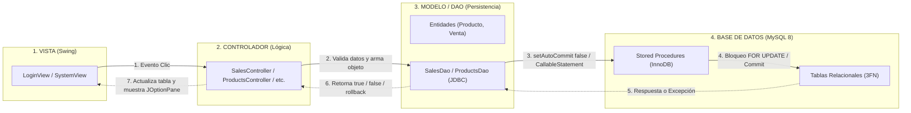

# 🧠 Guía Maestra de Estudio y Comprensión del Proyecto — TiendaGamer
**Para la Sustentación Final de Bases de Datos II / Proyecto Integrador (UNIAJC)**  
*Expositores: Johhan González Pajón & Valentina González Galíndez*  
*Docente Evaluador: Ing. Oscar Alberto Soto*

---

## 📌 ÍNDICE RÁPIDO DE ESTUDIO
1. [Arquitectura General: ¿Cómo fluye el sistema? (MVC + DAO)](#1-arquitectura-general-cómo-fluye-el-sistema-mvc--dao)
2. [El Secreto del Negocio: Transacciones ACID y Rollback en Java](#2-el-secreto-del-negocio-transacciones-acid-y-rollback-en-java)
3. [Lógica en la Base de Datos: Stored Procedures y Bloqueo Pesimista](#3-lógica-en-la-base-de-datos-stored-procedures-y-bloqueo-pesimista)
4. [Explicación Clase por Clase del Proyecto](#4-explicación-clase-por-clase-del-proyecto)
   - [Paquete Models (Conexión, Entidades y DAOs)](#paquete-models)
   - [Paquete Controllers (Lógica de Negocio y Eventos)](#paquete-controllers)
   - [Paquete Views (Interfaces Gráficas Swing)](#paquete-views)
5. [Las Nuevas Funcionalidades Explicadas al Detalle](#5-las-nuevas-funcionalidades-explicadas-al-detalle)
   - [A. Foto del Producto (Subida, preview y almacenamiento)](#a-foto-del-producto-subida-preview-y-almacenamiento)
   - [B. Kardex Continuo Inmutable y Ajuste por Mermas](#b-kardex-continuo-inmutable-y-ajuste-por-mermas)
   - [C. Conexión Dual Inteligente (Failover Nube / Local)](#c-conexión-dual-inteligente-failover-nube--local)
   - [D. Seguridad RBAC (Control de Acceso Basado en Roles)](#d-seguridad-rbac-control-de-acceso-basado-en-roles)
6. [Cómo Defenderte ante el Profesor Oscar Soto (Frases Clave)](#6-cómo-defenderte-ante-el-profesor-oscar-soto-frases-clave)

---

## 1. Arquitectura General: ¿Cómo fluye el sistema? (MVC + DAO)

En la sustentación, el profesor te preguntará: *"¿Cómo está organizado el software?"*. Tu respuesta debe ser inmediata: **Patrón Arquitectural MVC (Modelo-Vista-Controlador) desacoplado mediante el patrón de persistencia DAO (Data Access Object)**.



### ¿Por qué esta separación es tan importante?
1. **La Vista (`Views`):** Solo dibuja botones, tablas y cuadros de texto. **No tiene ni una sola línea de código SQL**. Si mañana se cambia Swing por una aplicación Web, la base de datos y la lógica ni se enteran.
2. **El Controlador (`Controllers`):** Es el intermediario inteligente. Escucha qué botón presionó el usuario, valida que no hayan campos vacíos o cantidades en cero, verifica los permisos del rol (RBAC) y le dice al DAO qué hacer.
3. **El DAO (`Models.*Dao`):** Es el único que toca la base de datos mediante JDBC. Administra la conexión, prepara sentencias (`PreparedStatement` / `CallableStatement`) y gobierna el control transaccional (commit/rollback).
4. **La Base de Datos (MySQL 8 con InnoDB):** No es un simple cascarón de tablas; ejecuta Stored Procedures precompilados que aseguran que las ventas, compras y el Kardex sean operaciones indivisibles.

---

## 2. El Secreto del Negocio: Transacciones ACID y Rollback en Java

El profesor evaluador hace mucho énfasis en la **transaccionalidad**. Si te pregunta: *"¿Qué pasa si al vender un producto se registra la cabecera de la factura pero se corta la luz antes de insertar el detalle?"*, aquí está tu defensa:

### ¿Qué significa ACID en nuestro proyecto?
* **A - Atomicidad:** La venta se guarda **completa** (Factura + Detalle + Descuento de Existencia + Asiento en Kardex) o **no se guarda absolutamente nada**.
* **C - Consistencia:** El inventario nunca puede quedar en negativo; las claves foráneas garantizan que no existan detalles huérfanos.
* **I - Aislamiento:** Si dos cajeros venden al mismo tiempo, el motor InnoDB aísla las transacciones para que ninguna sobreescriba a la otra.
* **D - Durabilidad:** Una vez hecho el `COMMIT`, los datos quedan guardados de forma permanente en el disco duro.

### ¿Cómo se programa el Rollback en Java? (El patrón que usamos en los DAOs)
Por defecto, JDBC tiene una opción llamada `autoCommit = true`, lo que significa que cada `INSERT` que ejecutas se guarda de inmediato en la base de datos sin vuelta atrás. **Eso es peligroso en una venta**.

Por eso, en `SalesDao.java` y `PurchasesDao.java` hacemos esto:

```java
Connection conn = null;
try {
    conn = cn.getConnection();
    // 1. DESACTIVAMOS el guardado automático:
    conn.setAutoCommit(false); 

    // 2. Ejecutamos la inserción de la Factura (Cabecera)
    // 3. Ejecutamos la inserción de los Productos (Detalle)
    // 4. Actualizamos el stock y el Kardex

    // 5. Si todo llegó aquí sin ningún error, CONFIRMAMOS los cambios:
    conn.commit(); 
    return true;

} catch (SQLException e) {
    // 6. ¡SI ALGO FALLÓ (luz, red, producto inválido), REVERTIMOS TODO!
    if (conn != null) {
        try {
            conn.rollback(); // <-- Deshace todas las operaciones previas
            System.err.println("Transacción cancelada: Rollback ejecutado.");
        } catch (SQLException ex) {
            ex.printStackTrace();
        }
    }
    return false;
} finally {
    // 7. Siempre devolvemos la conexión a su estado original
    if (conn != null) {
        conn.setAutoCommit(true);
    }
}
```
> **Frase para la exposición:** *"En nuestros DAOs gobernamos la conexión mediante `conn.setAutoCommit(false)`. Si ocurre una desconexión o fallo en mitad de la operación, el bloque `catch` invoca de forma inmediata `conn.rollback()`, garantizando Cero Facturas Huérfanas y Cero Descuadres de Inventario."*

---

## 3. Lógica en la Base de Datos: Stored Procedures y Bloqueo Pesimista

En la Diapositiva 6 y en las preguntas técnicas, defenderás los 3 Stored Procedures que creamos:

### 1. `sp_registrar_venta_pos` (Concurrencia y Bloqueo Pesimista)
* **¿Qué problema resuelve?** Imagina que en bodega queda **1 solo PlayStation 5**. Dos cajeros en diferentes computadores le dan clic a "Vender" al mismo milisegundo. Si no hay bloqueo, ambos leen `stock = 1`, la venta se procesa dos veces y el inventario queda en `-1` (producto vendido sin existir).
* **¿Cómo lo solucionamos?** Con la cláusula:
  ```sql
  SELECT quantity FROM products WHERE id = p_id_producto FOR UPDATE;
  ```
* **¿Qué hace `FOR UPDATE`?** Aplica un **bloqueo pesimista exclusivo a nivel de fila** en la memoria de InnoDB. El Cajero 1 adquiere el cerrojo; el Cajero 2 queda en espera durante milisegundos. Cuando el Cajero 1 termina y hace `COMMIT`, el stock ya es `0`. Cuando el Cajero 2 entra a evaluar, el procedimiento detecta que no hay existencias y arroja un error controlado (`SIGNAL SQLSTATE '45000'`).

### 2. `sp_registrar_compra`
* Recibe el proveedor, el empleado y los productos adquiridos.
* Inserta la orden de compra en `purchases` y sus renglones en `purchase_details`.
* **Suma las existencias físicas** al catálogo de productos y genera de forma automática un asiento de tipo **ENTRADA** en la tabla `kardex`, registrando el costo de compra unitario.

### 3. `sp_ajuste_inventario_kardex`
* Permite regularizar inventarios físicos ante diferencias detectadas en conteos de bodega (mermas por empaque averiado, roturas o sobrantes de fábrica).
* **Validaciones defensivas del Stored Procedure:**
  1. Valida que el empleado sea de rol autorizado (Administrador o Bodeguero).
  2. Valida que el motivo redactado tenga **más de 10 caracteres** (para que nadie escriba "ajuste" o cosas vagas, obligando a redactar una justificación pericial como "Avería de caja en transporte").
  3. Si es Merma, resta stock y verifica que el inventario no baje de cero. Si es Sobrante, suma stock.
  4. Asienta en Kardex el tipo de movimiento `AJUSTE` con el saldo anterior y saldo resultante.

---

## 4. Explicación Clase por Clase del Proyecto

### Paquete `Models`

#### 1. `ConnectionMySQL.java` (El corazón de la conexión)
* **¿Qué hace?** Gestiona la conexión a la base de datos con un mecanismo de **Failover Dinámico (Doble respaldo)**.
* **¿Cómo funciona?**
  1. Lee el archivo [db.properties](file:///c:/Users/Richa/OneDrive/Documentos/NetBeansProjects/TiendaGamer/db.properties).
  2. Intenta conectarse a la Nube (Aiven Cloud / Web) con un timeout de 1.5 segundos.
  3. Si el servidor remoto está suspendido o la sala de cómputo no tiene internet, **conmuta automáticamente a la base de datos Local (`localhost:3306`)** sin que el programa se cuelgue ni muestre pantallas rojas.
  4. Mantiene una conexión física compartida (`sharedPhysicalConnection`) para que las consultas posteriores respondan en **0 milisegundos** sin sobrecarga de apertura de sockets.

#### 2. Entidades de Dominio (`Products.java`, `Employees.java`, `Sales.java`, etc.)
* Son clases puras tipo POJO (Plain Old Java Object).
* Poseen atributos privados, constructores y métodos `getters` y `setters`.
* Representan fielmente el Diagrama de Clases UML del Sistema (por ejemplo, `Products` tiene `id`, `code`, `name`, `description`, `unit_price`, `product_quantity`, `image_path`, `category_id`, etc.).

#### 3. `EmployeesDao.java` (Seguridad y Login)
* **`encryptMD5(String password)`:** Transforma la contraseña plana (ej. `admin123`) en una cadena hexadecimal de 32 caracteres (`0192023a7bbd73250516f069df18b500`).
* **`loginQuery(String user, String password)`:**
  - Encripta la clave ingresada por el usuario.
  - Ejecuta `SELECT * FROM employees WHERE username = ? AND password = ?`.
  - Si encuentra coincidencia, puebla el objeto `Employees` con su nombre, ID y rol (`Administrador`, `Cajero (POS)`, `Bodeguero`), y lo retorna para gobernar los permisos de la sesión.

#### 4. `ProductsDao.java` (Catálogo y Existencias)
* Implementa las operaciones CRUD de los artículos.
* Valida códigos únicos para evitar duplicados en catálogo.
* Maneja el campo de la ruta/foto del periférico (`image_path`).
* Incluye métodos de búsqueda por coincidencia de texto para el buscador dinámico de la tabla.

#### 5. `SalesDao.java` y `PurchasesDao.java`
* Son los encargados de invocar los Stored Procedures mediante `CallableStatement cstmt = conn.prepareCall("{call sp_registrar_venta_pos(...)}");`.
* Gobiernan el `conn.setAutoCommit(false)` y el `conn.rollback()` explicados en la sección 2.

#### 6. `KardexDao.java` (Auditoría Forense)
* Consulta y filtra el historial de movimientos de inventario (`kardex`).
* Invoca `sp_ajuste_inventario_kardex` cuando el administrador o almacenista regulariza existencias físicas.

---

### Paquete `Controllers`

#### 1. `LoginController.java`
* Escucha el evento del botón `Ingresar` (`btn_enter`) o la tecla `Enter`.
* Valida que usuario y contraseña no estén vacíos.
* Llama a `EmployeesDao.loginQuery()`.
* Si las credenciales son válidas, instancia `new SystemView(loggedEmployee).setVisible(true)` y destruye el formulario de login.

#### 2. `SettingsControllers.java` (El Guardián del RBAC)
* Es uno de los controladores más importantes del proyecto.
* Recibe el empleado logueado y normaliza su rol mediante:
  ```java
  public String getRoleNormalized() {
      String r = loggedEmployee.getRol().toLowerCase().trim();
      if (r.contains("admin") || r.contains("gerente")) return "admin";
      if (r.contains("compra")) return "compras";
      if (r.contains("almacen") || r.contains("bodeg")) return "almacen";
      return "vendedor";
  }
  ```
* **Control de Menú Lateral:** En `addNavListener`, intercepta los clics en los botones de navegación. Si un Cajero hace clic en "Empleados" o "Configuración", el sistema bloquea el cambio de pestaña y muestra un diálogo de advertencia: *"Acceso Restringido: Tu perfil actual no tiene permisos autorizados"*.
* **Modo Solo Lectura:** En `lockProductButtons()`, si el usuario no es Administrador, desactiva los botones de registrar, modificar y desactivar productos, dejándolo únicamente como visor de precios.

#### 3. `ProductsController.java` (Gestión Multimedia y Semáforo)
* **Foto de Producto:** Escucha el clic en el botón de examinar foto, abre un `JFileChooser`, filtra por extensiones de imagen (.jpg, .png), redimensiona la imagen al tamaño exacto del panel (`JLabel`) con `Image.getScaledInstance()` y guarda la referencia en el producto.
* **Semáforo de Inventario:** Evalúa en tiempo real si el producto supera el stock mínimo (Verde), si está en el límite (Amarillo) o si está en cero (Rojo).

#### 4. `SalesController.java` (Punto de Venta POS)
* Administra la tabla temporal del carrito de compras.
* Al ingresar un código de barras o código numérico, busca el producto, verifica si hay existencias disponibles en memoria y calcula instantáneamente subtotales e impuestos.
* Al pulsar "Vender", solicita confirmación y envía la transacción atómica a `SalesDao`.

#### 5. `KardexController.java` (Ajustes y Auditoría)
* Carga la tabla de movimientos continuos: Fecha, Código, Nombre, Tipo de Movimiento (ENTRADA, SALIDA, AJUSTE), Responsable, Cantidad, Saldo Anterior y Saldo Resultante.
* Abre el modal de **Ajuste de Inventario Físico** con los campos de selección de producto, tipo de ajuste (Merma/Sobrante), cantidad de diferencia y área de texto para el motivo justificado.

---

### Paquete `Views`

#### 1. `LoginView.java`
* Diseñada con FlatLaf en tonos oscuros gamer (`#0b1f3a`).
* Controles limpios, bordes redondeados y foco automático en el campo de usuario.

#### 2. `SystemView.java`
* Formulario maestro de la aplicación con `JTabbedPane` configurado para navegación lateral fluida.
* **Perfil en el Encabezado:**
  - Foto de perfil del usuario logueado en un círculo recortado.
  - Nombre completo del usuario (`Johhan Gonzalez`, `Cajero POS Principal`, etc.).
  - Badge de rol estilizado: `● ADMINISTRADOR`, `● CAJERO (POS)`, `● BODEGUERO`.
  - Botón "Salir" que cierra la sesión y devuelve al Login.
* Contiene los formularios ergonómicos para cada uno de los módulos: Catálogo, Facturación, Compras, Kardex, Clientes, Empleados, Proveedores, Categorías y Reportes.

---

## 5. Las Nuevas Funcionalidades Explicadas al Detalle

### A. Foto del Producto (Subida, preview y almacenamiento)
* **¿Cómo se implementó?**
  1. En `SystemView.java` se incorporó un componente `JLabel` (`lbl_product_photo`) con borde decorativo en la pestaña de productos y un botón para seleccionar archivo.
  2. En `ProductsController.java`, al pulsar el botón se ejecuta un `JFileChooser` configurado con `FileNameExtensionFilter("Imágenes (*.jpg, *.png)", "jpg", "png", "jpeg")`.
  3. Cuando el usuario selecciona una foto, se lee con `new ImageIcon(ruta)` y se escala dinámicamente mediante:
     ```java
     Image img = icon.getImage().getScaledInstance(lblPhoto.getWidth(), lblPhoto.getHeight(), Image.SCALE_SMOOTH);
     lblPhoto.setIcon(new ImageIcon(img));
     ```
  4. La ruta del archivo se almacena en el objeto `Products` y se persiste en la columna `image_path` de la tabla `products`.
  5. Al hacer clic sobre cualquier fila de la tabla de productos, el controlador recupera la imagen asociada y la dibuja de inmediato en el recuadro visual.

### B. Kardex Continuo Inmutable y Ajuste por Mermas
* **¿Qué hace único a nuestro Kardex?**
  - **Inmutabilidad:** En la interfaz gráfica del Kardex **no existen botones para modificar ni eliminar registros**. Cada fila es una prueba pericial inalterable.
  - **Columnas de Control:** Muestra el `Saldo Anterior` y el `Saldo Posterior`. Si teníamos 10 teclados y se vendieron 2, el Kardex registra: `Cant: 2 | Efecto: SALIDA | Saldo Ant: 10 | Saldo Post: 8`.
  - **Ajuste Físico de Bodega:** Permite regularizar inventarios cuando en una auditoría física se detecta que hay menos unidades que en el sistema (por ejemplo, un mouse que se dañó en bodega). Se selecciona el producto, se marca como `MERMA`, se digita la cantidad dañada y se redacta la causa obligatoria (>10 caracteres). Al registrar, el Stored Procedure descuenta el stock y graba el movimiento `AJUSTE` con el nombre del responsable.

### C. Conexión Dual Inteligente (Failover Nube / Local)
* En la sustentación, muchos proyectos fallan porque intentan conectarse a una base de datos en internet y la red de la universidad se cae o bloquea los puertos.
* Nuestro sistema implementa en `ConnectionMySQL.java` una prueba previa con socket TCP (timeout 1500 ms). Si la Nube responde, trabaja en la nube; si la Nube está caída, **conmuta de inmediato a Localhost:3306** en silencio, mostrando en consola `[DB Failover] Conmutando a Base de Datos Local`. Esto garantiza que la sustentación **nunca se interrumpa**.

### D. Seguridad RBAC (Control de Acceso Basado en Roles)
* En la base de datos creamos las 3 cuentas de prueba oficiales:
  1. **`admin` / `admin123` (Rol: Administrador):** Tiene las llaves maestras de todo el sistema.
  2. **`cajero1` / `cajero123` (Rol: Cajero POS):** Solo puede entrar a Facturación POS, Clientes y consultar precios en Productos. Tiene bloqueado el acceso a Empleados, Proveedores, Reportes y Ajustes de Kardex.
  3. **`bodega1` / `bodega123` (Rol: Bodeguero):** Tiene acceso a Kardex, Ajuste Físico de Inventario, Recepción de Compras a Proveedores y Categorías. Tiene bloqueada la facturación de ventas y la nómina de empleados.

---

## 6. Cómo Defenderte ante el Profesor Oscar Soto (Frases Clave)

Memoriza estas 4 explicaciones directas para las intervenciones del profesor:

1. **Si te pregunta por qué Stored Procedures y no código Java:**
   > *"Profesor, porque los Stored Procedures se ejecutan dentro del motor MySQL con planes de ejecución precompilados en memoria. Eso reduce el tráfico de red de múltiples viajes a una sola petición y garantiza que las reglas de integridad y bloqueos pesimistas se apliquen en la fuente de los datos, protegiendo la base de datos incluso si alguien se conecta desde otro cliente externo."*

2. **Si te pregunta por la Tercera Forma Normal (3FN):**
   > *"Profesor, en nuestro MEER de 10 entidades cumplimos 1FN eliminando atributos multivaluados y garantizando atomicidad; cumplimos 2FN asegurando que todos los atributos dependan por completo de la clave primaria; y cumplimos 3FN eliminando dependencias transitivas (por ejemplo, separando categorías y proveedores en tablas independientes con sus propias claves primarias)."*

3. **Si te pregunta cómo controlaron la concurrencia:**
   > *"Implementamos bloqueo pesimista en InnoDB utilizando `SELECT ... FOR UPDATE` en el Stored Procedure `sp_registrar_venta_pos`. Esto adquiere un candado exclusivo sobre el registro del producto durante la transacción, asegurando que si dos hilos intentan vender el mismo artículo simultáneamente, el segundo hilo espere a que el primero haga commit, detectando de inmediato si el stock quedó agotado y evitando saldos negativos."*

4. **Si te pregunta por qué no se pueden borrar registros en el Kardex:**
   > *"Profesor, porque contable y pericialmente un Kardex representa la pista de auditoría inmutable de la empresa. Modificar o borrar filas destruiría la trazabilidad histórica. Si ocurre una diferencia o error, la regla de negocio exige asentar un movimiento compensatorio de tipo Ajuste por Merma o Sobrante con justificación formal."*

---

### Resumen para repasar antes de entrar al aula:
- **Johhan:** Domina el MEER 3FN, los Stored Procedures (`FOR UPDATE`), la arquitectura DAO, el Failover de conexión dual y las contraseñas MD5.
- **Valentina:** Domina la lógica de negocio POS, el semáforo de inventario y foto de productos, la inmutabilidad del Kardex, la justificación de mermas y las pruebas de Rollback transaccional.
- **Credenciales listas:** `admin` / `admin123` | `cajero1` / `cajero123` | `bodega1` / `bodega123`.
- **Diapositivas:** 9 diapositivas interactivas en [Presentacion_Sustentacion_TiendaGamer.html](file:///C:/Users/Richa/OneDrive/Desktop/Presentacion_Sustentacion_TiendaGamer.html).
